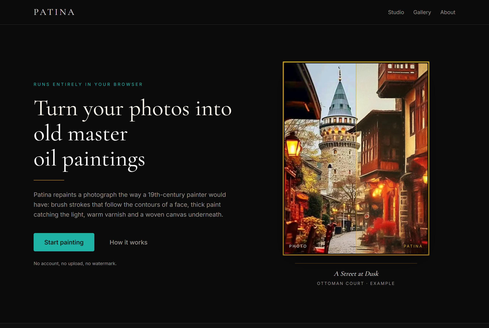
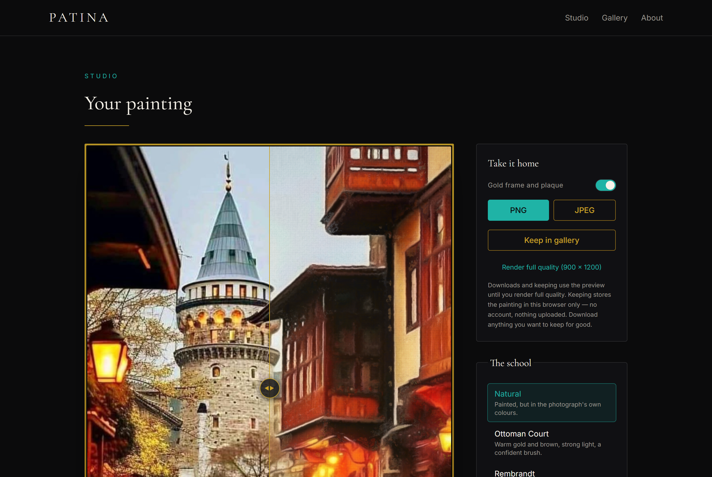
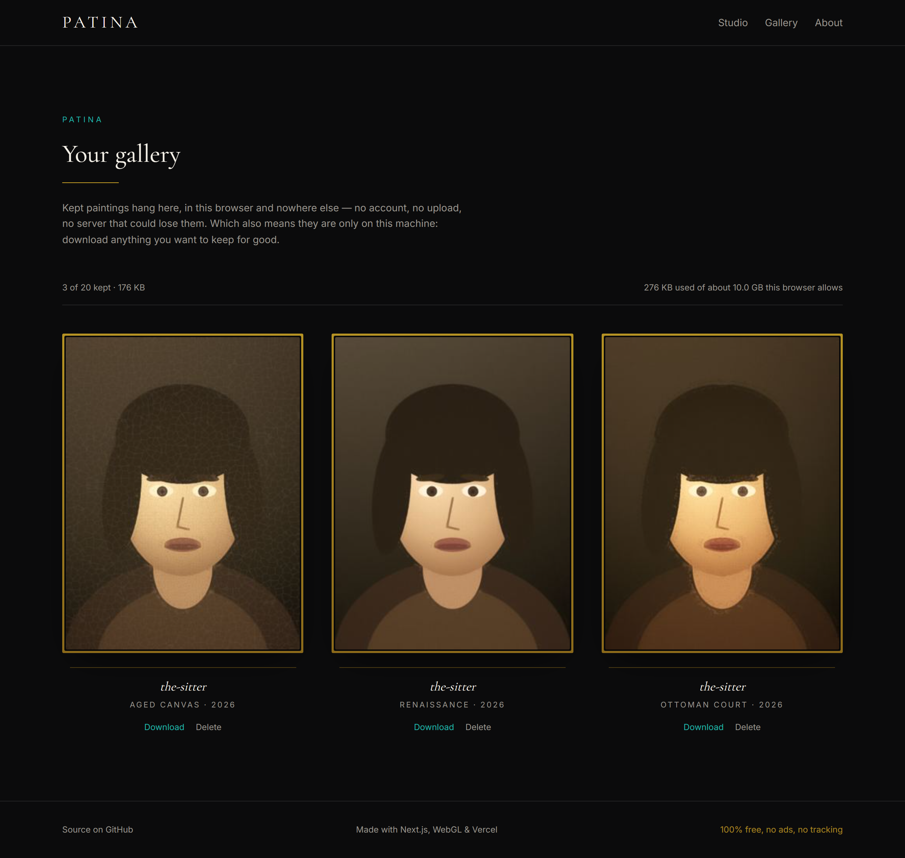

# Patina

**Turn your photos into old master oil paintings — in the browser, for free, without uploading anything.**

[**patina-art.vercel.app**](https://patina-art.vercel.app)



---

## What it is

Patina repaints a photograph the way a 19th-century painter would have, and then ages it: brush strokes that follow the shape underneath, thick paint catching the light, varnish that has yellowed, linen weave showing through.

There is no artificial intelligence here and **no server does the work.** The whole thing is a chain of WebGL2 shaders running on the visitor's own graphics card, a few hundred milliseconds at a time.

That is not a privacy policy written to sound reassuring — it is a description of how the code works. There is no upload step, there is no account, and the gallery lives in the visitor's own browser. The site has never asked anyone for an email address.

## How it works

Thirteen passes over the image, each one a fragment shader:

| | Pass | What it does |
|---|---|---|
| 1–2 | Linearise, denoise | sRGB to linear light, then a gentle blur so JPEG grain is not mistaken for detail |
| 3 | **Structure tensor** | A Sobel pass finds which way the image *flows* at every pixel |
| 4 | Smooth the flow | Separable Gaussian over the tensor, so the directions are coherent rather than per-pixel noise |
| 5 | **Anisotropic Kuwahara** | The heart of it. An ellipse stretched along the flow is split into eight sectors; the one with the least variance wins, weighted rather than winner-take-all. This is what makes strokes follow a cheekbone instead of a grid |
| 6 | Second, finer pass | Run again with a smaller brush, masked to only where the broad brush lost detail |
| 7 | Stroke shaping | Flow-aligned displacement and bristle furrows, so edges look dragged rather than cut |
| 8 | **Impasto** | Brightness becomes a height map, the height map becomes surface normals, and a light from the upper left catches the ridges |
| 9 | Tone | Saturation drops, highlights drift to cream, shadows to umber, blacks lift — varnish that has yellowed |
| 10 | Canvas weave | Procedural linen, drawn as parabolic thread crowns rather than a sine grid |
| 11 | Craquelure | Two-scale Worley noise, when asked for. Skipped entirely at zero rather than run with no effect |
| 12–13 | Vignette, linear to sRGB | Back into the colour space a screen understands |

Six presets ride on top: **Natural**, **Ottoman Court**, **Rembrandt**, **Renaissance**, **Baroque** and **Aged Canvas**. Fifteen sliders underneath, for anyone who wants to disagree with all six.



## Decisions worth reading

The interesting parts of this project are not the features. They are the places where the obvious thing was wrong.

**The eigenvector has to be computed in double-angle form.** The textbook `(λ₁ − g, f)` collapses to `(0, 0)` on a perfectly horizontal edge, which silently sends the brush the wrong way across exactly the features that matter most. `θ = ½·atan2(2f, e − g)` has no such hole.

**`gl.readPixels` at the end of the pipeline.** Without it the render timer reported about 1 ms, because WebGL only *queues* work. The honest number was two hundred times larger.

**The browser is not a trustworthy narrator of EXIF.** Some browsers auto-rotate a decoded image and ignore `imageOrientation: "none"`; others do not. Patina settles it at runtime by decoding a 2×1 pixel JPEG tagged "rotate 90" and measuring what comes back, then rotates only if the browser did not.

**The gallery is in IndexedDB, not in a database.** The plan called for Postgres and a storage bucket. That would have made the landing page's central claim untrue the moment anyone saved something, and would have put other people's photographs in a free tier that pauses after a week of quiet. The honest cost is written on the page: a gallery belongs to one browser.

**The header reads its session in the browser.** Reading cookies in the root layout would make every page dynamic — the landing page, the about page, all of it — for two words in a corner.

**A 4-pixel-tall slider is a 4-pixel touch target.** The track still looks 4px; it is drawn by `::-webkit-slider-runnable-track` while the element itself is 24.

## Privacy and security

- The photograph never leaves the device. No upload, no account, no analytics, no trackers — **measured, not claimed**: a live page load fetches from exactly one origin, its own. Even the two Google fonts are downloaded at build time and served from this domain.
- **EXIF is stripped, and that is proven rather than assumed.** A JPEG was built with a real APP1 block carrying GPS coordinates and a canary string in the `Make` tag, run through the studio, and read back out of storage: gone from the stored image, the thumbnail and both download formats.
- Uploads are checked by file signature, not by the name the operating system guessed.
- Full headers: CSP, `X-Frame-Options`, `nosniff`, `no-referrer`, `Permissions-Policy`, HSTS.

The full audit, including the one deliberate compromise in the CSP and why it is there, is in [`PROJECT.md`](PROJECT.md) §7.1.



## Built with

| | |
|---|---|
| **Next.js 16** (App Router) | The site, in TypeScript. Every page static |
| **WebGL2** | The painting engine, on your graphics card |
| **Tailwind CSS 4** | Styling |
| **IndexedDB** | The gallery, in your own browser |
| **Vercel** | Hosting |

No paid service, at any tier, now or later.

## Running it locally

```bash
git clone https://github.com/aliyev2007pa-ai/patina.git
cd patina
npm install
npm run dev
```

Then open <http://localhost:3000>. There is nothing to configure — no `.env`, no keys, no database.

> The build is pinned to webpack rather than Turbopack (`next dev --webpack`). Windows Application Control on the development machine blocks Next's native SWC binary; on a machine without that restriction the flag can be dropped.

## Layout

```
app/                 Pages, metadata, sitemap, error boundaries
components/          Studio, gallery, and the design system
lib/
  engine/            The oil paint pipeline
    shaders/         One file per pass
    cpu.worker.ts    Fallback for devices without WebGL2
  gallery/store.ts   IndexedDB
  image/             Validation, EXIF, decoding
PROJECT.md           The full specification and build log
```

## What it does not do

It is not a generative model, and it will not invent anything that was not in your photograph. A filter chain can give a photograph the *surface* of a painting — the strokes, the relief, the varnish — but it cannot restage a face into a composition the way a painter, or an image model, would. That ceiling was measured rather than guessed, and accepted deliberately.

There is also no Safari testing. There is no Apple device here to test on; every failure path in the engine is handled, so the worst it can do is fall back to the CPU painter.

## Licence

No licence chosen yet. This is an apprenticeship piece, built to learn the process.
